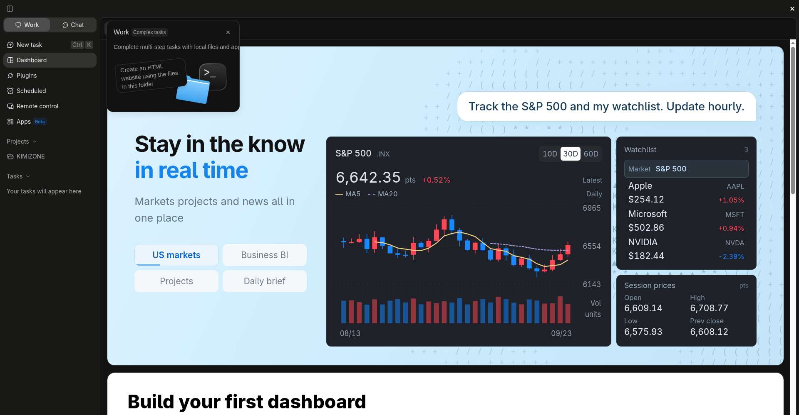
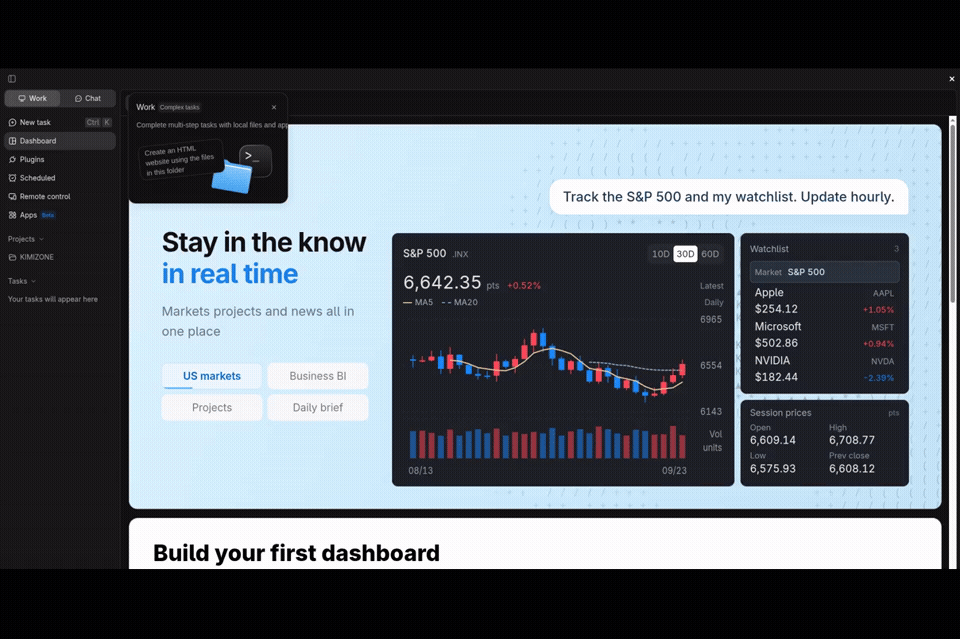
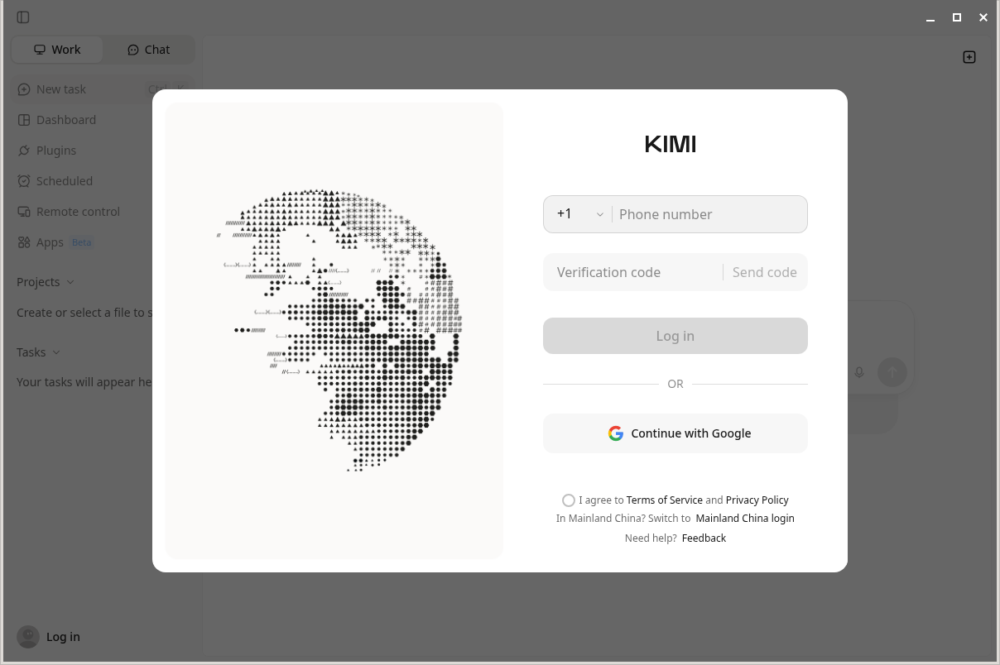

# KimiDeck

**Created by OSINTCabal**

Version **1.0.0**.

A Kimi desktop integration for **Fedora and Debian Linux (x86-64)**. Keep the Kimi interface, run its bundled tools, and manage Linux updates from the desktop or terminal. KimiDeck is part of my desktop app series alongside [VibeDeck](https://github.com/OSINTCabal/VibeDeck), [GrokDeck](https://github.com/OSINTCabal/GrokDeck), and [MinimaxDeck](https://github.com/OSINTCabal/MinimaxDeck).

[Install](docs/INSTALL.md) · [Development](docs/DEVELOPMENT.md) · [Verification](docs/VERIFICATION.md)



## Features

The existing Kimi desktop app runs on a matching Electron Linux runtime. Linux shims handle overlay dismissal, Escape controls, and title-bar contrast while preserving the Kimi interface.

The integration includes per-user installation, checksum-verified runtime downloads, update staging, rollback, and local native-module builds. The `kimideck`, `kimi-desktop`, and `kimidesktop` commands open the same app. Windows-only slide and messaging tools run through Wine when installed.

## How it works

1. **Kimi application:** The installer obtains the upstream Windows package and prepares it for the matching Electron Linux runtime. Your Kimi account provides the upstream app features.
2. **Linux integration:** Local scripts handle native dependencies, launchers, the desktop icon, updates, and rollback. UI shims handle overlay dismissal and window-control contrast. Windows-only slide and messaging tools use Wine.
3. **Local data:** This repository contains the integration source. Application bundles, runtimes, account profiles, and compiled dependencies stay outside Git. Installing or updating the integration preserves your profile.

KimiDeck is unofficial and is not affiliated with Moonshot AI.

## Installation

Fedora and Debian use **one repository and the same installer**. Follow the [installation guide](docs/INSTALL.md) for your distribution's system packages, then run:

```bash
bash install.sh
~/.local/bin/kimideck
```

Node 18 or newer is required for installation. Updates use the installed Electron runtime. Optional Windows tools need Wine, installed separately.

To rebuild from a downloaded installer:

```bash
bash install.sh --from-file /path/to/kimi_3.2.20.exe --version 3.2.20
```

Downloads from the official update feed are checked against its checksum metadata. A local installer is supplied by you and does not have independent feed verification.

The default installation is `~/.local/opt/kimi-desktop`. The `kimideck`, `kimi-desktop`, and `kimidesktop` commands point to the same launcher. Existing Kimi profiles remain in their original location. The installer refuses to replace unrelated commands.

## Updates and rollback

```bash
kimideck --update --check
kimideck --update --stage
# Close Kimi before rolling back.
kimideck --update --rollback
```

A complete staged version becomes active on the next launch. The previous version is retained for rollback. Existing installations may have a daily systemd update timer; templates are included under `share/systemd`. Fresh installation currently uses manual and in-app updates.

## Uninstall

```bash
~/.local/opt/kimi-desktop/uninstall.sh
# Explicitly delete the Kimi profile too:
~/.local/opt/kimi-desktop/uninstall.sh --purge
```

Ordinary uninstall preserves the account profile. Purge deletes it, including saved sign-in data. The integration supports XDG config, cache, and data locations.

## Development

```bash
node --test tests/*.test.cjs
for f in install.sh kimi-desktop.sh uninstall.sh updater/*.sh; do sh -n "$f" || exit; done
```

Use a disposable installation with `KIMI_DESKTOP_ROOT`, `XDG_BIN_HOME`, and `XDG_DATA_HOME` when testing. Do not point development uninstall or rollback tests at your working installation.

## Notes

- Baseline: Kimi 3.2.20 with Electron 43.7.3. Upstream changes may require new integration patches.
- The initial installer needs internet access and several gigabytes of temporary disk space.
- ASAR symlinks are rejected during extraction. A future upstream package using them requires a reviewed compatibility change.
- A terminal command returning immediately is not enough to identify a launch failure. Check the Kimi log under the XDG config directory. Do not delete profile locks while another instance is running.
- The MIT license covers this repository's integration code. Upstream application and dependency licenses still apply; installation retains their bundled notices.

## Screenshots and video

[](docs/media/overview.mp4)

[Watch or download the MP4 overview](docs/media/overview.mp4). The dashboard serves as this release's homepage preview. The video opens with that signed-in capture, then shows a fresh Debian installation's sign-in screen and country selector. The account footer has been cropped from the homepage preview. This is an interface overview, not a recorded AI coding session.

Fresh installations on both distributions:

| Fedora 44 | Debian 12 |
| --- | --- |
|  |  |

The sign-in screenshots and recording use disposable profiles with no saved credentials. See [verification](docs/VERIFICATION.md) for the install, runtime, and terminal checks.

## Coming soon

More desktop features, packaging improvements, and broader Linux desktop testing are planned.
